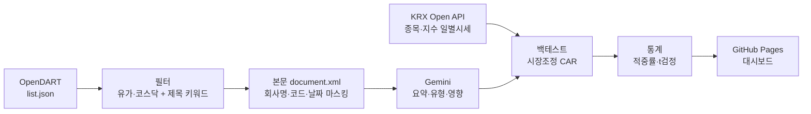

# DART 공시 요약·분류봇

매일 아침 전날 나온 DART 주요 공시를 받아서 **Gemini가 요약하고 유형·영향(긍정/부정/중립)으로 분류**합니다.
그다음 **공시 후 실제 주가 반응으로 그 분류가 맞았는지 채점**합니다. 전 과정이 GitHub Actions에서 사람 손 없이 돌아가고, 결과는 대시보드로 공개됩니다.

- 대시보드: https://yoonjb020927.github.io/dart-disclosure-bot/
- 만든 이유: "LLM이 공시를 읽고 주가 방향을 맞힐 수 있는가?"를 숫자로 검증해 보기 위해서입니다.

## 핵심 결과

> 최근 1년(2025-11-24 ~ 2026-11-23) 소급 결과는 분류가 끝나면 여기에 채웁니다.
> 유형별 평균 CAR, 방향 적중률, 표본 수를 적고, 유의한 것(p<0.05)과 아닌 것을 구분합니다.

## 구조



| 단계 | 모듈 |
|---|---|
| 공시 수집 | `dart_client.py`, `filters.py` |
| LLM 분류 | `masking.py`, `llm/`, `classify_runner.py` |
| 주가 | `krx_client.py`, `prices.py` |
| 검증 | `backtest.py`, `stats.py` |
| 대시보드 | `site/` |
| 자동화 | `pipeline.py`, `.github/workflows/` |

## 검증 방법

- **이벤트일 t0**: 공시 접수일. 휴장일이면 다음 거래일로 잡습니다. 기준가는 t0 전 거래일 종가라서, 장중 공시와 장 마감 후 공시가 모두 반영됩니다.
- **CAR[0,+k]**: t0부터 k거래일 뒤까지 (종목 수익률 − 시장지수 수익률)을 더한 값입니다. 시장지수는 코스피 종목이면 KOSPI, 코스닥 종목이면 KOSDAQ을 씁니다. k는 1, 5, 20입니다.
- **수익률은 KRX 등락률(`FLUC_RT`)로 계산**합니다. 종가만 비교하면 무상증자 권리락 날 주가가 반토막 난 것처럼 보여서 가짜 −50% 수익률이 나옵니다. 등락률은 조정된 기준가 대비 값이라 이 문제가 없습니다.
- **적중 판정**: CAR[0,+1]이 +1%를 넘으면 실제 "긍정", −1% 아래면 "부정", 그 사이면 "중립"으로 보고, LLM 예측과 비교합니다. 0.5%와 2% 기준도 함께 보여줍니다.
- **거래정지 등으로 시세가 없는 종목**은 0%로 채우지 않고 집계에서 뺍니다.
- **live와 backfill을 분리**합니다.
  - live: 운영을 시작한 뒤 그날그날 분류한 공시입니다. 분류 시점에 결과가 존재하지 않았으니 깨끗한 검증입니다.
  - backfill: 과거 공시를 나중에 분류한 것입니다. 모델이 학습 중에 그 뒤의 뉴스를 봤을 수 있습니다. 이를 줄이려고 회사명·종목코드·날짜를 가리고 공시 내용만 보여주지만, 완전히 막지는 못합니다.
- 모델이나 프롬프트를 바꾸면 결과를 **분류기 버전별로 따로** 집계합니다. 표본이 30건 미만인 그룹에는 "표본 부족"을 표시합니다.

## 한계

- 표본 크기: 무상증자, 최대주주 변경처럼 드문 유형은 1년 치로도 표본이 적습니다.
- 시장조정 모델은 단순합니다. 종목 베타를 반영하지 않습니다.
- backfill에는 미래 정보가 섞였을 가능성이 있습니다(위 참고).
- 무료 Gemini 모델을 씁니다. 하루 호출 한도 때문에 1년 치 분류에는 여러 날이 걸립니다.
- 제목 키워드 필터에 걸리지 않는 주요 공시는 빠집니다. 대시보드 "운영 현황"에서 제외된 제목을 보고 규칙을 보완합니다.
- GitHub은 60일 동안 저장소 활동이 없으면 예약 실행을 멈춥니다. 이 봇은 매일 데이터를 커밋하므로 해당하지 않습니다.

## 데이터 이용 조건

- KRX Open API 약관은 받은 데이터를 **제3자에게 제공하는 것을 제한**합니다. 그래서 KRX 주가 원본(`data/prices/`)은 git에 커밋하지 않고 **GitHub Actions 캐시에만** 저장합니다. 캐시는 저장소가 공개여도 외부에서 내려받을 수 없습니다.
- 캐시가 지워지면(7일 미사용 등) 다음 daily 실행이 저장된 공시 기간의 주가를 자동으로 다시 받습니다.
- 저장소와 대시보드에는 DART 공시 정보, LLM 분류 결과, 주가에서 계산한 초과수익률(CAR) 통계만 올라갑니다.
- 공개 전에 KRX 약관에서 가공 통계 공개가 허용되는지 직접 확인하세요.

## 실행 방법

### 1. 키 발급 (모두 무료)

| 키 | 발급처 | 비고 |
|---|---|---|
| `DART_API_KEY` | [OpenDART](https://opendart.fss.or.kr) → 인증키 신청 | 일 20,000회 |
| `GEMINI_API_KEY` | [Google AI Studio](https://aistudio.google.com) → Get API key | 무료 구간 |
| `KRX_API_KEY` | [KRX Open API](https://openapi.krx.co.kr) | 아래 4개 서비스 **이용 신청** 필요 |

KRX 서비스: 유가증권 일별매매정보, 코스닥 일별매매정보, KOSPI 시리즈 일별시세정보, KOSDAQ 시리즈 일별시세정보

### 2. 로컬

```bash
uv venv .venv && uv pip install -e ".[dev]"
cp .env.example .env              # 키 3개 입력 (커밋되지 않음)
python -m dartbot probe dart       # API 연결 확인 (krx, gemini도)
pytest --cov=dartbot               # 테스트
python -m dartbot daily            # 어제 공시 수집 → 분류 → 백테스트 → site/
python -m http.server -d site      # 대시보드 미리보기
```

### 3. GitHub 자동화

1. 공개 저장소에 push합니다.
2. Settings → Secrets and variables → Actions에 키 3개를 등록합니다.
3. Settings → Pages → Source를 **GitHub Actions**로 설정합니다.
4. Actions → **backfill**을 3개월씩 4번 실행합니다. OpenDART 일일 한도 때문에 나눠서 실행합니다.
   `20251124–20260223`, `20260224–20260523`, `20260524–20260823`, `20260824–20261123`
5. `src/dartbot/config.py`의 `LIVE_START_DATE`는 운영 시작일(2026-11-24)로 설정되어 있습니다.
6. 이후 **daily**가 매일 07:00 KST에 돌면서 새 공시를 수집하고, 남은 대기열을 하루 한도만큼 분류하고, 대시보드를 갱신합니다. 실패하면 Issue가 자동으로 생깁니다.

## 향후 계획

- 같은 공시를 여러 LLM으로 분류해서 정확도 비교 (`llm/base.py`의 `Classifier`만 구현하면 됩니다)
- 시장모형(베타 추정) 기반 초과수익률
- 텔레그램 아침 요약 알림

---
이 프로젝트는 학습·연구용이며 투자 조언이 아닙니다.
